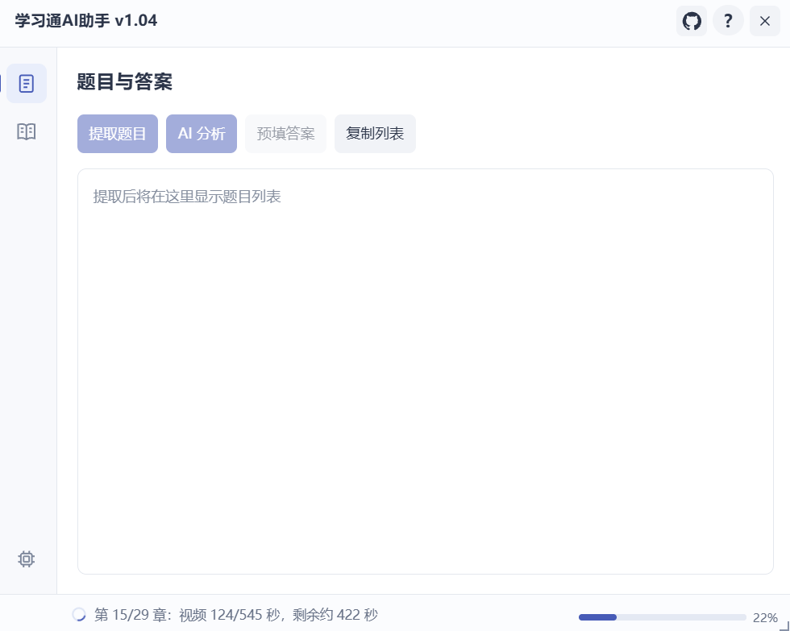
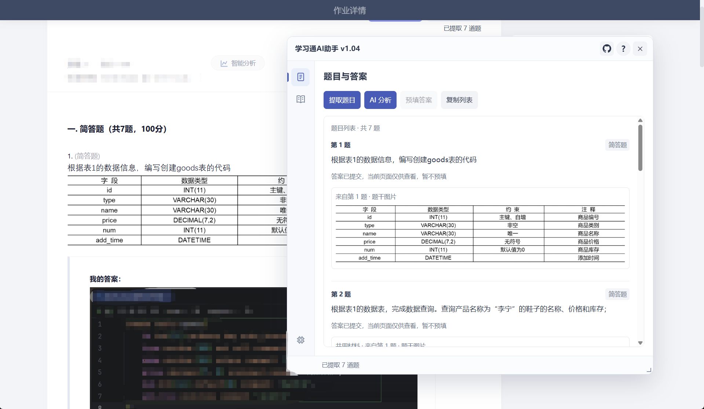
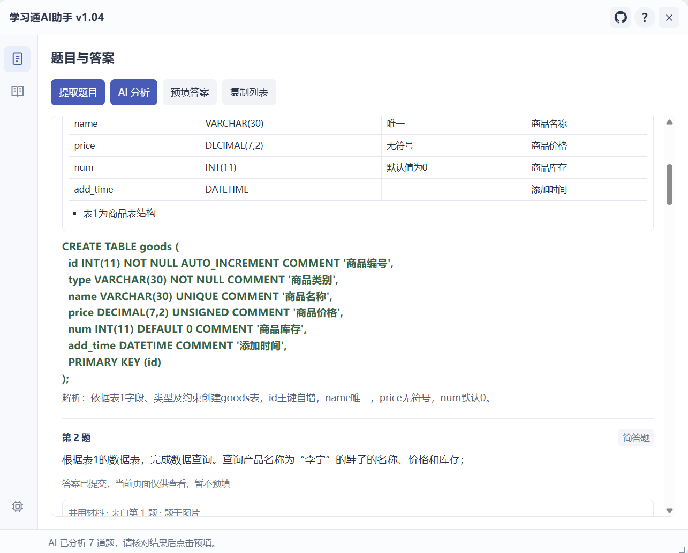
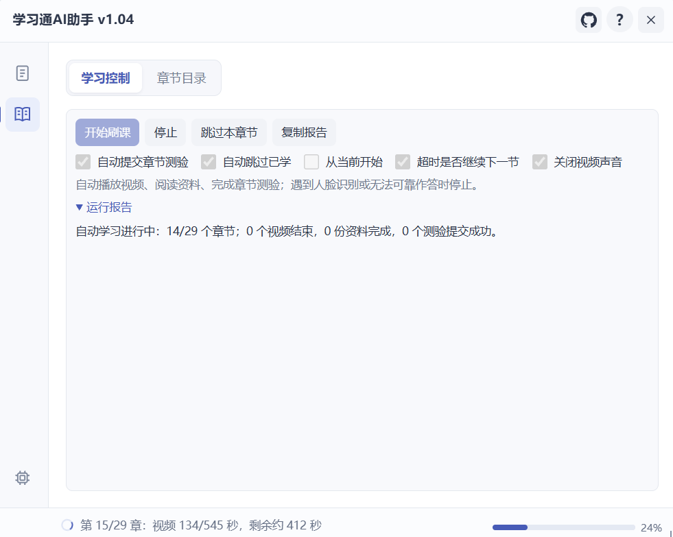
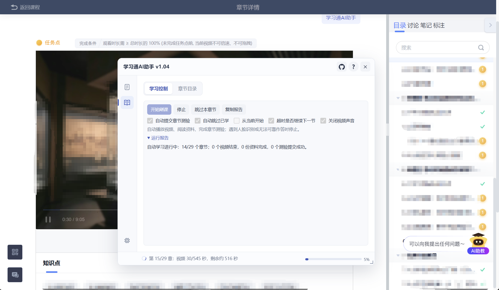
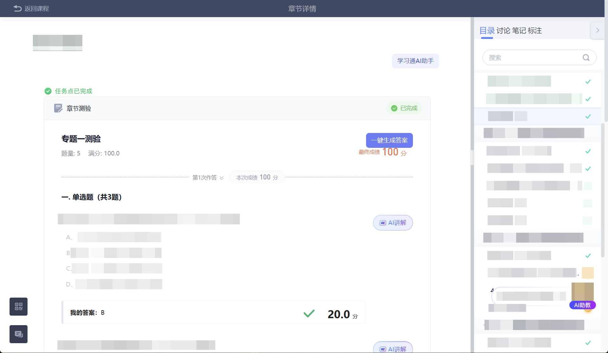
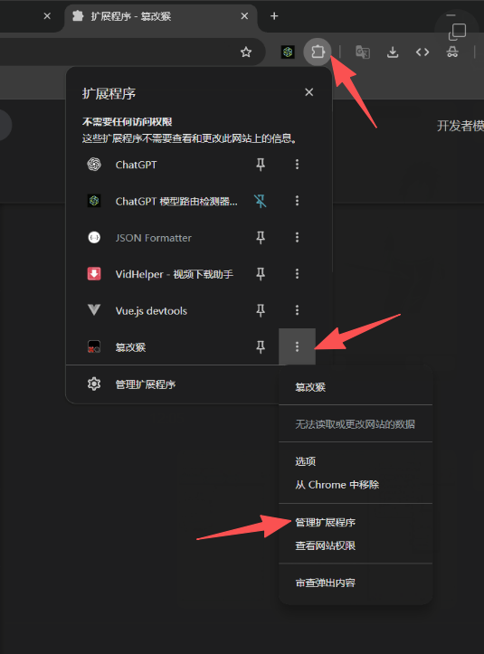
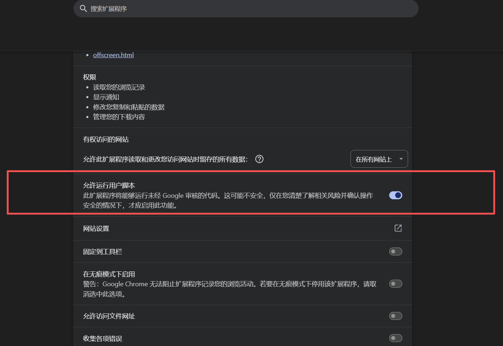

  

> 衷心感谢各位的真实使用与测评，推动工具不断优化！如果遇到题目未适配或其他 Bug，请及时[联系作者](https://github.com/zhu-hailin)或提交 [Issue](https://github.com/zhu-hailin/chaoxing-ai-assistant/issues)。
>
> ⚠️本工具将继续长期维护。

# 学习通AI助手

免费的学习通网页辅助脚本，配合篡改猴（Tampermonkey）使用。

- **AI 答题**：章节测验与作业识别、逐题图文分析、答案与解析、原生预填。
- **自动刷课**：视频、PPT 与章节测验处理，提供章节目录和视频进度。
- **自定义设置**：配置模型、API Key 和学习开关。

## 程序预览

| 题目与答案 | 题目图片 |
| :---: | :---: |
|  |  |
| **AI 答案与解析** | **自动刷课** |
|  |  |
| **视频进度** | **章节测验入口** |
|  |  |

## 安装与使用

首次安装可查看 **[图文安装教程](docs/学习通脚本安装教程.md)**，包含篡改猴安装、允许用户脚本及助手安装步骤。

1. 安装并启用 [篡改猴（Tampermonkey）](https://www.tampermonkey.net/)，点击上方链接确认安装或更新，然后刷新学习通页面。
2. 打开「学习通AI助手」，在「设置 → 模型设置」配置模型和自己的 API Key；图片题请选择支持图片的模型。
3. 测验或作业使用「一键生成答案」，核对结果后保存或提交；课程学习页面进入「自动刷课」，按需调整开关后开始。

题目列表支持题号定位、未完成筛选、单题复制和原图查看。

未弹出安装页时，可打开 [完整脚本](学习通AI助手.user.js)，复制到篡改猴编辑器并保存。

### 没有显示脚本窗口？

如果安装后没有显示「学习通AI助手」窗口，请按下图进入篡改猴扩展管理页，开启「允许运行用户脚本」，然后刷新学习通页面。

| ① 进入篡改猴管理页 | ② 开启「允许运行用户脚本」 |
| :---: | :---: |
| 浏览器扩展按钮 → 篡改猴右侧 ⋮ → 管理扩展程序 | 开启下图标出的开关，然后刷新学习通页面 |
|  |  |

## 版本更新

更新说明与完整脚本下载见 **[GitHub 发行版](https://github.com/zhu-hailin/chaoxing-ai-assistant/releases)**。

## 使用说明

- AI 答案请自行核对；人脸识别、验证码及未适配的任务需人工处理。
- 完成状态以平台为准，跳过或超时的任务仍需完成。
- API Key 与学习开关保存在篡改猴存储中；更新脚本后请刷新课程页面。
- 无人值守刷课与自动提交可能影响学习记录或成绩，请遵守课程要求。详见 [使用风险说明](docs/脚本使用风险分析报告.md)。

## 开源协议与费用

本项目采用 [MIT 协议](LICENSE)，允许使用、修改、分发和商业使用，需保留版权与许可声明。

脚本免费提供。API Key 需自行准备，调用费用由模型服务商收取。

本项目为第三方工具，与超星、学习通及 DeepSeek 官方无隶属关系。字体解密基于 wyn665817 的「超星字体解密」脚本，保留原作者署名与 MIT 许可。

## 参与贡献

不同学校的学习通系统、页面和题型可能有所不同。如果你所在学校需要适配，欢迎贡献代码；也欢迎大家完善文档、反馈问题，一起完成更多学校的适配。

- **贡献代码或文档**：Fork 本仓库，修改后提交 [Pull Request](https://github.com/zhu-hailin/chaoxing-ai-assistant/pulls)，说明适用场景、修改内容和验证情况。
- **反馈问题或建议**：提交 [Issue](https://github.com/zhu-hailin/chaoxing-ai-assistant/issues)，附上脚本版本、页面类型、复现步骤及必要截图，截图请遮挡个人信息与 API Key。

提交前请阅读 [协作规则](AGENTS.md)，修改时保留已有功能和使用流程。

## 支持作者

如果您觉得这个工具不错，可以请作者喝杯咖啡！☕
