# 学习通脚本安装教程

---

## ①安装篡改猴插件

⚠️如果你有魔法，直接在Edge / 谷歌浏览器扩展商店安装即可。

Edge / 谷歌浏览器通用方法：

1.打开链接：https://chrome.zzzmh.cn/info/dhdgffkkebhmkfjojejmpbldmpobfkfo

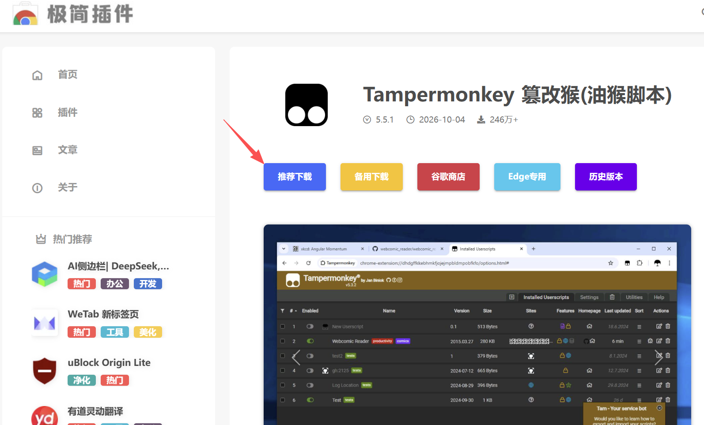

点击「推荐下载」。

2.下载7zip解压工具：https://www.7-zip.org/（如果你的电脑是32位或者是AMD芯片的请使用下面的）

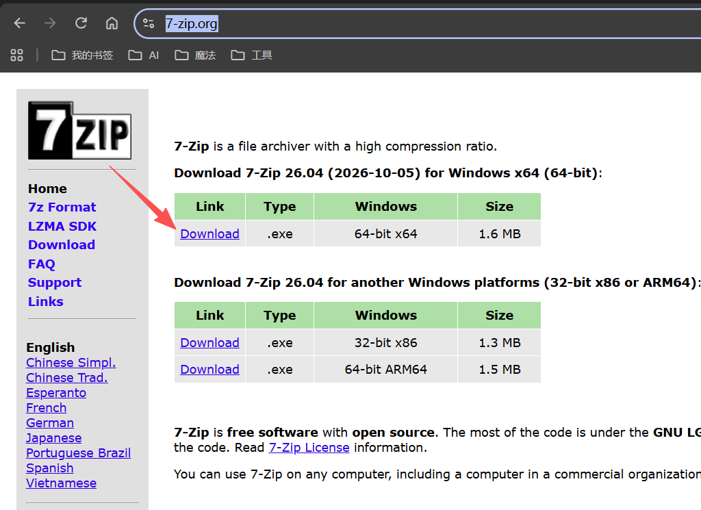

3.解压篡改猴压缩包

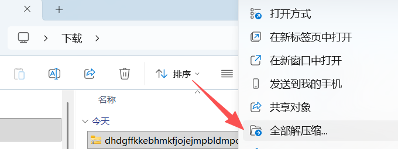

4.进入解压的文件夹

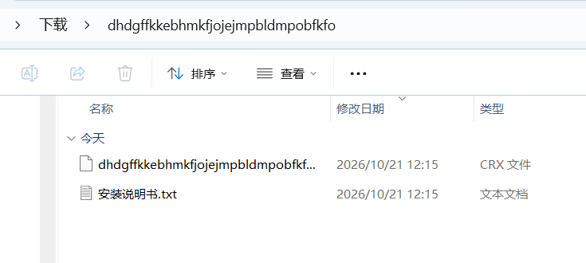

5.使用7zip解压CRX文件

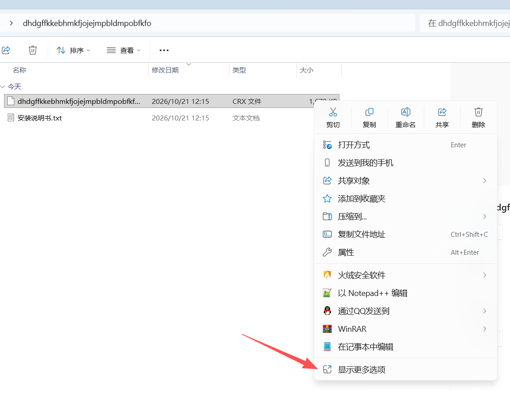

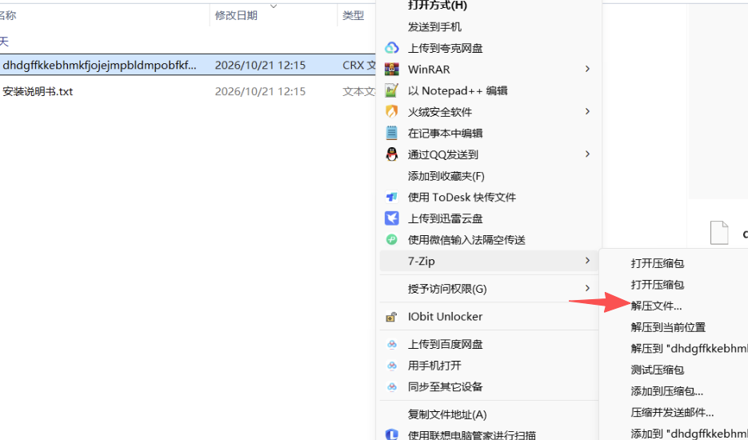

6.在Edge/谷歌浏览器打开扩展

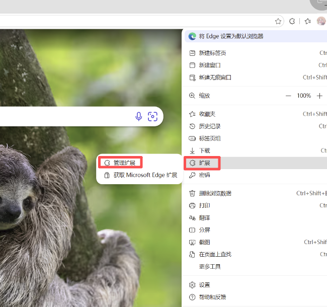

7.打开开发人员模式

8.选择刚刚的文件夹安装

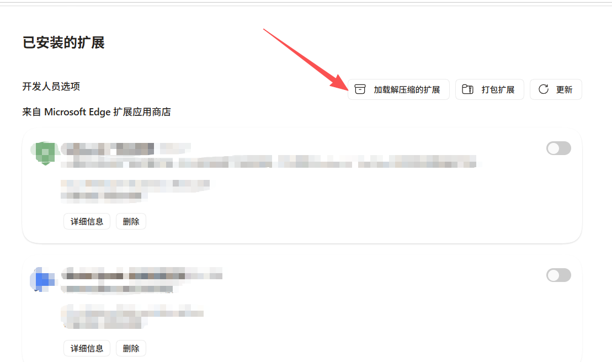

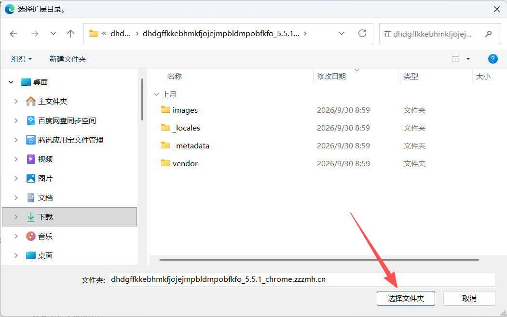

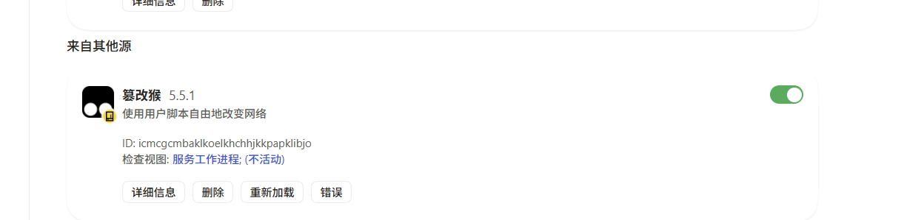

9.打开「允许用户脚本」

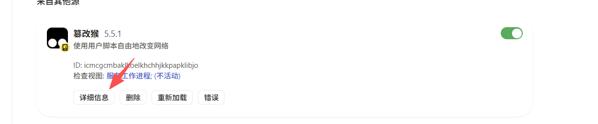

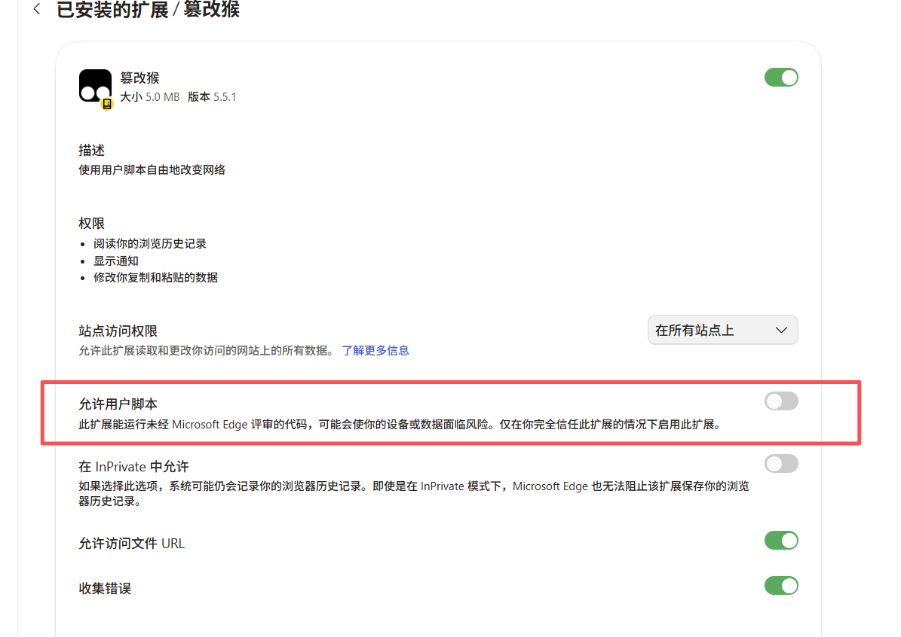

## ②安装工具

打开官方项目：https://github.com/zhu-hailin/chaoxing-ai-assistant

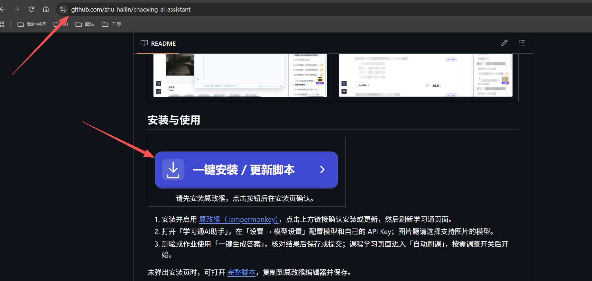

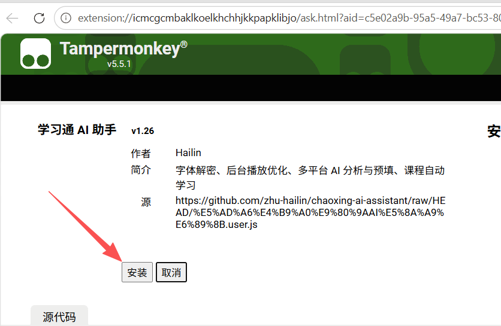

## ③安装完成，打开学习通看效果

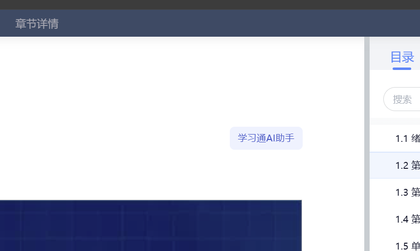

显示「学习通AI助手」，表示安装成功