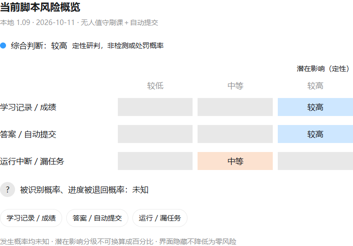

# 脚本使用风险分析报告

评估日期：2026-10-11。依据：原 1.09 源码评估、已有运行反馈、学校公开说明，以及 1.11 的故障保护和人工题处理修改。用户确认原课程测验正常跳过；其他功能的模拟测试与现场证据见验证记录。运行补强不消除平台检测或错误答题风险。

**按“无人值守刷课＋自动提交”的用途，综合风险定性评为较高。发生概率未知，不能换算成被识别或处罚的百分比。**这不是平台官方评级，也没有证据表明当前用户的账号已被识别或处罚。

原概览图对应初始公开版本；1.11 的运行补强见下表与验证记录，未据此调整未知的故障或检测发生率。

[交互图文件](脚本使用风险分析图.html)下载后用浏览器打开，可查看各项依据。

| 风险项 | 潜在影响分级 | 已有依据与限制 |
| --- | --- | --- |
| 学习记录与成绩 | 较高 | 学校公开说明存在异常记录清除、进度退回；当前账号发生概率未知。 |
| 答案与自动提交 | 较高 | 流程校验不能证明模型答案正确；错误答案提交后可能影响成绩。没有当前脚本的准确率或错误提交率统计。 |
| 运行中断与漏任务 | 中等 | 有验证提示停止、进度检查及平台完成标记校验；1.11 增加连续三章超时停止、待处理清单和确认重试，模拟验证通过。无法自动答题的测验可以保留并跳过，不提交、不计完成。队列结束仍可能留有未完成任务，实际故障发生率未知。 |
| 识别当前脚本 | 无法量化 | 页面可观察共享 DOM、焦点与部分合成事件；未确认当前课程正在采集哪些特征，也没有该账号的检测结果。 |

分级比较潜在影响和需要谨慎处理的程度，不是发生率测量。没有处罚样本的分母、使用时长统计和当前课程的检测规则，不能给出 10%、30% 或 70% 等数字。

## 依据

- 桂林理工大学 2022-05-13 的通报确认平台曾筛查并清除异常学习记录，列出的异常包括实际学习时长、做题时长及 IP 地址跨度。该通报不能推导出本脚本的检测概率。[原通报](https://nnfx.glut.edu.cn/jxjy/info/1159/1064.htm)
- 广东科技学院 2026-05-25 的说明确认异常学习数据可能导致进度退回，需要重新正常学习。[学校说明](https://www.gdust.edu.cn/jwc/jiaowu/20260525/10074.html)
- Chrome 内容脚本与网页共享 DOM；`HTMLElement.click()` 和 `dispatchEvent()` 等合成事件可以具有 `isTrusted=false`。可观察操作不等于能确定具体脚本。[Chrome 文档](https://developer.chrome.com/docs/extensions/develop/concepts/content-scripts)、[事件来源](https://developer.mozilla.org/en-US/docs/Web/API/Event/isTrusted)
- 当前源码支持自动分析、预填和提交；提交结果不确定时停止。1.11 在超时继续分支增加三章连续失败阈值，导航恢复与休息保留计数，只有平台确认章节完成或原本已完成才清零。重试需要用户确认，并阻止提交结果不明的测验再次自动提交。人工题判断及跳过不能证明支持题的模型答案正确；超时、跳过或未处理章节不计入已完成数。

## 优先降低的风险

1. 核对本校和课程规则，采用允许的学习辅助方式，由本人实际学习。
2. 关闭自动提交，人工核对答案后提交。
3. 完成现场验收后使用连续失败停止、待处理清单和人工确认重试，检查失败原因后再继续。
4. 将源码检查、模拟回归与现场验收分开记录。播放测试通过不证明平台检测风险消失。

界面隐藏只是显示控制，不能阻止平台读取业务记录，也不构成“无法检测”的保证。该评估不包含对第三方模型服务的数据保留政策、操作系统安全或所有学校处分规则的完整审计。
